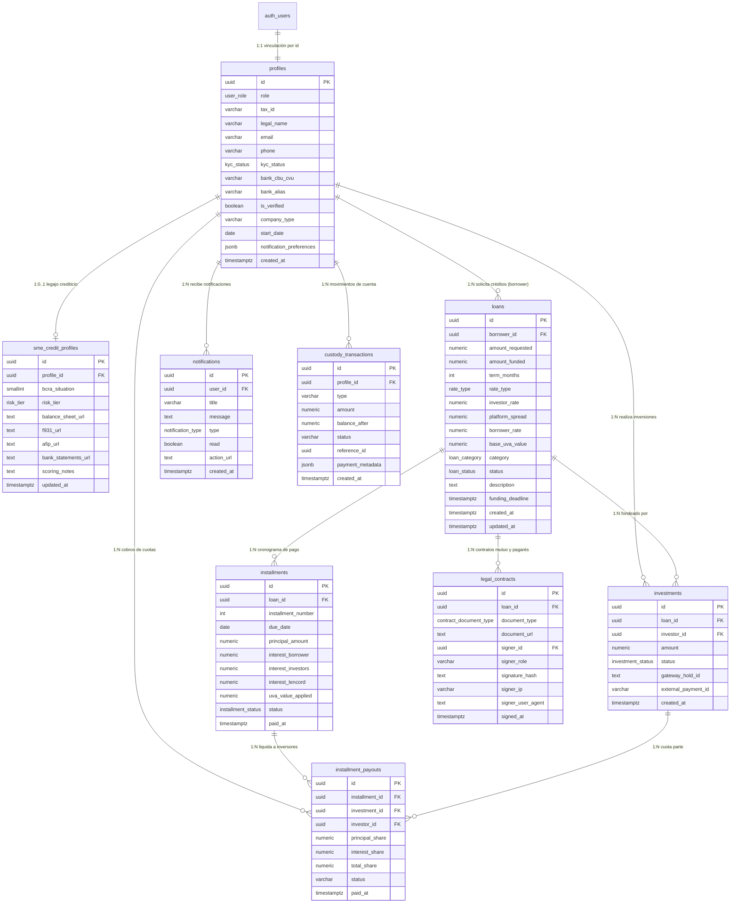

# Documentación de la Base de Datos (Supabase / PostgreSQL)

Documentación técnica y funcional del modelo relacional, políticas de seguridad (RLS), procedimientos almacenados (RPCs), almacenamiento de archivos (Storage) y triggers de la plataforma **Lencord**.

---

## 1. Visión General de la Arquitectura

La base de datos de Lencord opera sobre **PostgreSQL 15+** en la nube de **Supabase**, estructurada bajo los siguientes principios:

- **Aislamiento y Seguridad con RLS:** Row Level Security (RLS) habilitado en el 100% de las tablas del esquema `public` y en el bucket de `storage`.
- **Integridad Transaccional Atómica:** Lógica financiera crítica (compromisos de subasta, checkout con saldos en custodia, cobranzas y distribución proporcional de cuotas) encapsulada en procedimientos almacenados (`SECURITY DEFINER`) con bloqueos pesimistas (`FOR UPDATE`).
- **Libro Contable Inmutable (Ledger):** Registro cronológico y auditable de movimientos en custodia a través de `custody_transactions`.
- **Sincronización de Identidad:** Trigger automático que sincroniza los registros creados en `auth.users` hacia la tabla `public.profiles`.
- **Notificaciones en Tiempo Real:** Publicación en `supabase_realtime` para suscripciones instantáneas en el cliente.
- **Extensiones Habilitadas:** `pgcrypto` para hashing criptográfico y UUIDs.

---

## 2. Diagrama Entidad-Relación (ERD)



---

## 3. Tipos Enumerados (ENUMs)

| Nombre ENUM | Valores Válidos | Descripción |
| :--- | :--- | :--- |
| `user_role` | `'investor'`, `'borrower'`, `'sme'`, `'admin'` | Clasificación del usuario en la plataforma. |
| `kyc_status` | `'pending'`, `'approved'`, `'rejected'` | Estado de verificación de identidad / Know Your Customer. |
| `risk_tier` | `'Tier A'`, `'Tier B'`, `'Tier C'` | Nivel de riesgo crediticio asignado a la PyME. |
| `rate_type` | `'TNA_FIXED'`, `'CER_VARIABLE'` | Modalidad de tasa de interés (TNA fija o ajustada por inflación UVA/CER). |
| `loan_category` | `'working_capital'`, `'machinery'`, `'refinancing'`, `'expansion'`, `'new_sme'` | Destino de los fondos solicitados por la PyME. |
| `loan_status` | `'draft'`, `'in_review'`, `'funding'`, `'funded'`, `'active'`, `'repaid'`, `'cancelled'`, `'rejected'`, `'expired'` | Ciclo de vida de la solicitud y subasta del préstamo. |
| `investment_status` | `'committed'`, `'settled'`, `'refunded'` | Estado del compromiso monetario del inversor. |
| `installment_status` | `'pending'`, `'paid'`, `'overdue'` | Estado de vencimiento y pago de cada cuota mensual. |
| `contract_document_type` | `'mutuo'`, `'pagare'` | Tipo de instrumento legal digital emitido. |
| `notification_type` | `'info'`, `'success'`, `'warning'` | Severidad o tipo visual de la notificación. |

---

## 4. Diccionario de Tablas (Esquema `public`)

### 4.1. `profiles`
Almacena la información extendida de la entidad usuaria (inversores, representantes de PyMEs y administradores), vinculada 1:1 con `auth.users`.

| Columna | Tipo | Nulable | Default / Restricciones | Descripción |
| :--- | :--- | :---: | :--- | :--- |
| `id` | `UUID` | No | PK, `REFERENCES auth.users(id) ON DELETE CASCADE` | Identificador único del usuario (heredado de Supabase Auth). |
| `role` | `user_role` | No | `'investor'` | Rol de acceso principal. |
| `tax_id` | `VARCHAR(11)` | Sí | Formato regex: DNI (7-8 dígitos) o CUIT/CUIL (11 dígitos). | CUIT, CUIL o DNI del titular o representante legal. Opcional en el registro inicial de inversores. |
| `legal_name` | `VARCHAR(255)` | No | - | Razón social de la PyME o Nombre completo del inversor. |
| `first_name` | `VARCHAR(100)` | Sí | `NULL` | Nombre de pila del titular o representante. |
| `last_name` | `VARCHAR(100)` | Sí | `NULL` | Apellido del titular o representante. |
| `email` | `VARCHAR(255)` | Sí | `NULL` | Correo electrónico de contacto. |
| `phone` | `VARCHAR(50)` | No | `''` | Teléfono o número de WhatsApp verificado. |
| `kyc_status` | `kyc_status` | No | `'pending'` | Estado del legajo de identidad. |
| `bank_cbu_cvu` | `VARCHAR(22)` | No | `'0000000000000000000000'` | CBU bancario o CVU de billetera virtual para transferencias. |
| `bank_alias` | `VARCHAR(100)` | Sí | `NULL` | Alias bancario legible (ej. `mi.empresa.mp`). |
| `is_verified` | `BOOLEAN` | No | `false` | Bandera de verificación manual por compliance. |
| `company_type` | `VARCHAR(50)` | Sí | `NULL` | Tipo societario (ej. `SAS`, `SA`, `SRL`, `Monotributo`, `Responsable Inscripto`). |
| `start_date` | `DATE` | Sí | `NULL` | Fecha de inicio de actividades comerciales informada ante AFIP/ARCA. |
| `notification_preferences` | `JSONB` | No | `'{"email": true, "sms": true, "whatsapp": true}'` | Preferencias de canales de contacto. |
| `created_at` | `TIMESTAMPTZ` | No | `now()` | Fecha y hora de creación de la cuenta. |

---

### 4.2. `sme_credit_profiles`
Registra la calificación de riesgo crediticio de la PyME y las referencias a sus documentos contables en Supabase Storage.

| Columna | Tipo | Nulable | Default / Restricciones | Descripción |
| :--- | :--- | :---: | :--- | :--- |
| `id` | `UUID` | No | PK, `gen_random_uuid()` | Identificador del legajo. |
| `profile_id` | `UUID` | No | FK `profiles(id) ON DELETE CASCADE` | Perfil de la empresa solicitante. |
| `bcra_situation` | `SMALLINT` | Sí | `CHECK (bcra_situation >= 1 AND bcra_situation <= 5)` | Situación crediticia Central de Deudores BCRA (1=Normal a 5=Irrecuperable, o `NULL` si no registra deuda). |
| `risk_tier` | `risk_tier` | No | `'Tier B'` | Categoría de riesgo asignada por Lencord. |
| `balance_sheet_url` | `TEXT` | Sí | `NULL` | Ruta o URL del balance contable auditado en PDF. |
| `f931_url` | `TEXT` | Sí | `NULL` | Ruta o URL del formulario 931 (cargas sociales) en PDF. |
| `afip_url` | `TEXT` | Sí | `NULL` | Ruta o URL de la constancia de inscripción AFIP/ARCA en PDF. |
| `bank_statements_url` | `TEXT` | Sí | `NULL` | Ruta o URL de los extractos bancarios recientes en PDF. |
| `scoring_notes` | `TEXT` | No | `''` | Justificación técnica de riesgo o notas del analista. |
| `updated_at` | `TIMESTAMPTZ` | No | `now()` | Fecha de última actualización de scoring. |

---

### 4.3. `loans`
Contiene las solicitudes de financiamiento publicadas en la subasta y su estado evolutivo.

| Columna | Tipo | Nulable | Default / Restricciones | Descripción |
| :--- | :--- | :---: | :--- | :--- |
| `id` | `UUID` | No | PK, `gen_random_uuid()` | Identificador único del préstamo. |
| `borrower_id` | `UUID` | No | FK `profiles(id) ON DELETE RESTRICT` | Perfil prestatario (PyME). |
| `amount_requested` | `NUMERIC(14,2)` | No | `CHECK (amount_requested > 0)` | Monto solicitado en ARS. |
| `amount_funded` | `NUMERIC(14,2)` | No | `0.00`, `CHECK (amount_funded >= 0 AND amount_funded <= amount_requested)` | Monto acumulado en compromisos de inversión. |
| `term_months` | `INT` | No | `CHECK (term_months > 0)` | Plazo en meses (ej. 1, 2, 3, 6, 12). |
| `rate_type` | `rate_type` | No | - | Modalidad de tasa pactada (`TNA_FIXED` o `CER_VARIABLE`). |
| `investor_rate` | `NUMERIC(5,2)` | No | `0.00` | TNA nominal anual ofrecida a los inversores. |
| `platform_spread` | `NUMERIC(5,2)` | No | `0.00` | Spread / comisión porcentual de intermediación de Lencord. |
| `borrower_rate` | `NUMERIC(5,2)` | No | `0.00` | TNA total asumida por el prestatario (`investor_rate + platform_spread`). |
| `base_uva_value` | `NUMERIC(10,4)` | Sí | `NULL` | Cotización base de la unidad UVA al momento de adjudicación (para créditos CER). |
| `category` | `loan_category` | No | - | Destino productivo de los fondos. |
| `status` | `loan_status` | No | `'in_review'` | Estado operativo del préstamo. |
| `description` | `TEXT` | Sí | `NULL` | Memoria descriptiva del proyecto ingresada por la PyME. |
| `funding_deadline` | `TIMESTAMPTZ` | Sí | `NULL` | Fecha y hora límite para alcanzar el 100% en la subasta. |
| `created_at` | `TIMESTAMPTZ` | No | `now()` | Fecha de registro de la solicitud. |
| `updated_at` | `TIMESTAMPTZ` | No | `now()` | Fecha de última modificación. |

---

### 4.4. `investments`
Registra los aportes individuales de cada inversor en un préstamo subastado.

| Columna | Tipo | Nulable | Default / Restricciones | Descripción |
| :--- | :--- | :---: | :--- | :--- |
| `id` | `UUID` | No | PK, `gen_random_uuid()` | Identificador único de la inversión. |
| `loan_id` | `UUID` | No | FK `loans(id) ON DELETE RESTRICT` | Préstamo asociado. |
| `investor_id` | `UUID` | No | FK `profiles(id) ON DELETE RESTRICT` | Perfil del inversor. |
| `amount` | `NUMERIC(14,2)` | No | `CHECK (amount > 0)` | Monto comprometido en ARS. |
| `status` | `investment_status` | No | `'committed'` | Estado de la inversión (`committed`, `settled`, `refunded`). |
| `gateway_hold_id` | `TEXT` | Sí | `NULL` | Identificador de retención en pasarela de pago bancaria o fintech. |
| `external_payment_id` | `VARCHAR(100)` | Sí | `NULL` | Comprobante externo de transferencia. |
| `created_at` | `TIMESTAMPTZ` | No | `now()` | Fecha y hora del aporte. |

---

### 4.5. `installments`
Cronograma amortizable de cuotas del préstamo (capital, intereses y honorarios de la plataforma).

| Columna | Tipo | Nulable | Default / Restricciones | Descripción |
| :--- | :--- | :---: | :--- | :--- |
| `id` | `UUID` | No | PK, `gen_random_uuid()` | Identificador de la cuota. |
| `loan_id` | `UUID` | No | FK `loans(id) ON DELETE CASCADE` | Préstamo al que pertenece la cuota. |
| `installment_number` | `INT` | No | `CHECK (installment_number > 0)` | Número de cuota ordinal (1 a N). |
| `due_date` | `DATE` | No | - | Fecha de vencimiento de la cuota. |
| `principal_amount` | `NUMERIC(14,2)` | No | `CHECK (principal_amount >= 0)` | Amortización de capital del período. |
| `interest_borrower` | `NUMERIC(14,2)` | No | `CHECK (interest_borrower >= 0)` | Interés total liquidado a cobrar a la PyME. |
| `interest_investors` | `NUMERIC(14,2)` | No | `CHECK (interest_investors >= 0)` | Interés total neto a repartir entre los inversores. |
| `interest_lencord` | `NUMERIC(14,2)` | No | `0.00`, `CHECK (interest_lencord >= 0)` | Margen de intermediación retenido por Lencord. |
| `uva_value_applied` | `NUMERIC(10,4)` | Sí | `NULL` | Valor UVA aplicado en la fecha de liquidación. |
| `status` | `installment_status` | No | `'pending'` | Estado (`pending`, `paid`, `overdue`). |
| `paid_at` | `TIMESTAMPTZ` | Sí | `NULL` | Fecha y hora efectiva en que se cobró la cuota. |

---

### 4.6. `legal_contracts`
Instrumentos legales vinculantes (contrato de mutuo colectivo y pagaré digital con firma electrónica).

| Columna | Tipo | Nulable | Default / Restricciones | Descripción |
| :--- | :--- | :---: | :--- | :--- |
| `id` | `UUID` | No | PK, `gen_random_uuid()` | Identificador del contrato. |
| `loan_id` | `UUID` | No | FK `loans(id) ON DELETE RESTRICT` | Préstamo asociado. |
| `document_type` | `contract_document_type` | No | - | Tipo de documento (`mutuo` o `pagare`). |
| `document_url` | `TEXT` | No | - | Enlace al PDF del contrato o pagaré generado. |
| `signer_id` | `UUID` | Sí | FK `profiles(id) ON DELETE SET NULL` | Usuario firmante del documento. |
| `signer_role` | `VARCHAR(20)` | Sí | `NULL` | Rol en el contrato (ej. `borrower`, `platform`). |
| `signature_hash` | `TEXT` | Sí | `NULL` | Hash SHA-256 de la firma electrónica. |
| `signer_ip` | `VARCHAR(45)` | Sí | `NULL` | Dirección IP desde donde se estampó la firma. |
| `signer_user_agent` | `TEXT` | Sí | `NULL` | Navegador y sistema operativo del firmante para trazabilidad. |
| `signed_at` | `TIMESTAMPTZ` | Sí | `NULL` | Momento de la firma digital. |

---

### 4.7. `notifications`
Bandeja de notificaciones en plataforma con soporte Realtime.

| Columna | Tipo | Nulable | Default / Restricciones | Descripción |
| :--- | :--- | :---: | :--- | :--- |
| `id` | `UUID` | No | PK, `gen_random_uuid()` | Identificador de la notificación. |
| `user_id` | `UUID` | No | FK `profiles(id) ON DELETE CASCADE` | Destinatario de la alerta. |
| `title` | `VARCHAR(255)` | No | - | Título resumido del evento. |
| `message` | `TEXT` | No | - | Detalle explicativo de la notificación. |
| `type` | `notification_type` | No | `'info'` | Nivel visual (`info`, `success`, `warning`). |
| `read` | `BOOLEAN` | No | `false` | Indicador de lectura. |
| `action_url` | `TEXT` | Sí | `NULL` | Enlace relativo de navegación (ej. `/dashboard/pyme`). |
| `created_at` | `TIMESTAMPTZ` | No | `now()` | Fecha y hora de emisión. |

---

### 4.8. `custody_transactions`
Libro mayor (Ledger) inmutable que audita el saldo en custodia de cada usuario.

| Columna | Tipo | Nulable | Default / Restricciones | Descripción |
| :--- | :--- | :---: | :--- | :--- |
| `id` | `UUID` | No | PK, `gen_random_uuid()` | Identificador de la transacción contable. |
| `profile_id` | `UUID` | No | FK `profiles(id) ON DELETE CASCADE` | Titular de la cuenta en custodia. |
| `type` | `VARCHAR(50)` | No | - | Tipo de movimiento: `deposit`, `investment_hold`, `installment_payout`, `withdrawal`. |
| `amount` | `NUMERIC(14,2)` | No | `CHECK (amount > 0)` | Importe involucrado en la transacción. |
| `balance_after` | `NUMERIC(14,2)` | No | - | Saldo resultante en custodia posterior al movimiento. |
| `status` | `VARCHAR(20)` | No | `'completed'` | Estado de la transacción contable (`completed`, `reversed`, etc.). |
| `reference_id` | `UUID` | Sí | `NULL` | ID del préstamo, cuota o pago asociado. |
| `payment_metadata` | `JSONB` | Sí | `NULL` | Información complementaria de la pasarela (tarjeta, método, cuota, etc.). |
| `created_at` | `TIMESTAMPTZ` | No | `now()` | Marca temporal de la transacción. |

---

### 4.9. `installment_payouts`
Detalle de liquidación a prorrata de cada cuota cobrada a favor de los inversores.

| Columna | Tipo | Nulable | Default / Restricciones | Descripción |
| :--- | :--- | :---: | :--- | :--- |
| `id` | `UUID` | No | PK, `gen_random_uuid()` | Identificador de la liquidación. |
| `installment_id` | `UUID` | No | FK `installments(id) ON DELETE RESTRICT` | Cuota cancelada. |
| `investment_id` | `UUID` | No | FK `investments(id) ON DELETE RESTRICT` | Inversión participante. |
| `investor_id` | `UUID` | No | FK `profiles(id) ON DELETE RESTRICT` | Inversor acreedor. |
| `principal_share` | `NUMERIC(14,2)` | No | - | Porción de capital cobrada por el inversor. |
| `interest_share` | `NUMERIC(14,2)` | No | - | Porción de interés cobrada por el inversor. |
| `total_share` | `NUMERIC(14,2)` | No | - | Monto total acreditado (`principal_share + interest_share`). |
| `status` | `VARCHAR(20)` | No | `'credited'` | Estado del pago (`credited`, `pending`). |
| `paid_at` | `TIMESTAMPTZ` | No | `now()` | Fecha y hora de acreditación. |

> **Restricción de unicidad:** `UNIQUE (installment_id, investment_id)` para garantizar idempotencia e impedir dobles pagos de una misma cuota sobre una inversión.

---

## 5. Procedimientos Almacenados y Triggers

### 5.1. Funciones de Seguridad y Triggers del Sistema

#### `public.is_admin() RETURNS BOOLEAN`
- **Modo:** `SECURITY DEFINER`
- **Lógica:** Retorna `true` si el usuario autenticado (`auth.uid()`) posee `role = 'admin'` en `public.profiles` o si la petición fue invocada con el token `service_role`.

#### `public.handle_new_user() RETURNS TRIGGER`
- **Trigger:** `AFTER INSERT ON auth.users` (`on_auth_user_created`)
- **Lógica:** Se ejecuta inmediatamente al crearse una cuenta en Supabase Auth. Extrae de `raw_user_meta_data`: `role`, `tax_id`, `legal_name`, `first_name`, `last_name`, `company_type`, `start_date`. Inserta de forma idempotente (`ON CONFLICT (id) DO UPDATE`) en `public.profiles`.

#### `public.handle_loan_approval_notification() RETURNS TRIGGER`
- **Trigger:** `AFTER UPDATE OF status ON public.loans` (`trg_notify_loan_approval`)
- **Lógica:** Al pasar el estado de un préstamo a `'funding'` (aprobado por auditoría admin), genera automáticamente una notificación dirigida a la PyME informando la apertura de la subasta.

---

### 5.2. Procedimientos RPC Financieros (Transaccionales)

#### `commit_investment_atomic(p_loan_id UUID, p_investor_id UUID, p_amount NUMERIC) RETURNS JSONB`
- **Modo:** `SECURITY DEFINER`
- **Propósito:** Inversión atómica directa en subasta.
- **Validaciones:**
  1. `p_amount > 0`.
  2. Bloqueo pesimista `SELECT * FROM loans WHERE id = p_loan_id FOR UPDATE`.
  3. Comprueba que el estado sea `'funding'`.
  4. Impide autofinanciamiento: `borrower_id != p_investor_id`.
  5. Protección contra sobre-fondeo: `(amount_funded + p_amount) <= amount_requested`.
- **Efectos:**
  - Actualiza `loans.amount_funded`.
  - Si alcanza el 100%, conmuta `status` a `'funded'`.
  - Inserta el registro en `investments`.

#### `public.process_investment_checkout_rpc(p_loan_id UUID, p_investor_id UUID, p_amount NUMERIC, p_payment_method TEXT, p_card_last_four TEXT, p_card_brand TEXT) RETURNS JSONB`
- **Modo:** `SECURITY DEFINER`
- **Propósito:** Flujo completo de checkout de inversión.
- **Validaciones y Lógica:**
  1. Bloqueo de fila del préstamo (`FOR UPDATE`).
  2. Verificación de cupo disponible y prohibición de autofinanciamiento.
  3. Si `p_payment_method = 'custody_balance'`, consulta el último `balance_after` en `custody_transactions` del inversor; si es insuficiente, aborta con excepción. Debita el saldo.
  4. Si es pasarela externa (tarjeta/transferencia), preserva el saldo en custodia y asienta el comprobante.
  5. Actualiza `loans` y crea el registro en `investments`.
  6. Inserta el movimiento `'investment_hold'` en `custody_transactions`.
  7. **Notificaciones bidireccionales:**
     - Notifica a la PyME sobre el nuevo aporte y porcentaje completado.
     - Notifica al Inversor con el monto comprometido.
     - Si la subasta alcanza el 100% (`funded`), notifica a la PyME para firmar el pagaré digital y a todos los inversores participantes sobre la finalización exitosa.

#### `public.process_installment_repayment_rpc(p_installment_id UUID, p_payer_id UUID) RETURNS JSONB`
- **Modo:** `SECURITY DEFINER`
- **Propósito:** Pago de cuota de la PyME y distribución equitativa de capital e intereses.
- **Validaciones y Lógica:**
  1. Bloqueo pesimista de la cuota (`installments FOR UPDATE`).
  2. Valida que la cuota no esté previamente pagada.
  3. Calcula el total financiado y recorre las inversiones asociadas (`status IN ('committed', 'settled')`).
  4. Distribuye `principal_share` e `interest_share` proporcionalmente al aporte de cada inversor, aplicando compensación exacta de centavos en la última cuota para evitar discrepancias por redondeo.
  5. Inserta los registros en `installment_payouts`.
  6. Acredita el dinero en `custody_transactions` (`type = 'installment_payout'`) para cada inversor acreedor.
  7. Envía notificaciones a cada inversor acreditado y a la PyME.
  8. Verifica si no quedan cuotas pendientes: si todas están pagas, actualiza el préstamo a `status = 'repaid'` y emite la notificación de cancelación total del crédito.

---

## 6. Políticas de Seguridad (Row Level Security - RLS)

Todas las tablas tienen RLS habilitado. La siguiente matriz detalla los privilegios concedidos:

| Tabla | Operación | Rol de Usuario | Condición de Acceso |
| :--- | :--- | :--- | :--- |
| **`profiles`** | `ALL` | Administrador | `public.is_admin()` |
| | `SELECT` | Propio usuario | `auth.uid() = id` |
| | `SELECT` | Público / Inversores | Si el perfil es `borrower`/`sme` o posee préstamos solicitados. |
| | `SELECT` | PyME (borrower) | Puede ver perfiles de inversores que hayan aportado a sus préstamos. |
| | `UPDATE` | Propio usuario | `auth.uid() = id` |
| | `INSERT` | Autenticado / Trigger | Permitido para nuevos registros (`WITH CHECK (true)`). |
| **`sme_credit_profiles`** | `ALL` | Administrador | `public.is_admin()` |
| | `SELECT` | Propio usuario / Público | Propietario (`profile_id = auth.uid()`) o consultas de riesgo aprobadas. |
| | `INSERT` | PyME (borrower) | `profile_id = auth.uid()` |
| | `UPDATE` | PyME (borrower) | `profile_id = auth.uid()` |
| **`loans`** | `ALL` | Administrador | `public.is_admin()` |
| | `SELECT` | Público / Inversores | Préstamos en subasta o activos (`status IN ('funding', 'funded', 'active', 'repaid')`). |
| | `SELECT` | PyME propietaria | `auth.uid() = borrower_id` (incluye estados `draft` e `in_review`). |
| | `INSERT` | PyME propietaria | `auth.uid() = borrower_id AND status IN ('draft', 'in_review')`. |
| | `UPDATE` | PyME propietaria | `auth.uid() = borrower_id`. |
| **`investments`** | `ALL` | Administrador | `public.is_admin()` |
| | `SELECT` | Inversor | `auth.uid() = investor_id`. |
| | `SELECT` | PyME prestataria | Si el préstamo asociado le pertenece (`loans.borrower_id = auth.uid()`). |
| **`installments`** | `ALL` | Administrador | `public.is_admin()` |
| | `SELECT` | PyME o Inversor | Acceso mediante vistas y consultas autenticadas vinculadas al préstamo. |
| **`notifications`** | `ALL` | Administrador | `public.is_admin()` |
| | `SELECT` | Destinatario | `auth.uid() = user_id`. |
| | `UPDATE` | Destinatario | `auth.uid() = user_id` (para marcar como leída). |
| **`custody_transactions`** | `ALL` | Administrador | `public.is_admin()` |
| | `SELECT` | Propietario | `profile_id = auth.uid()`. |
| **`installment_payouts`** | `ALL` | Administrador | `public.is_admin()` |
| | `SELECT` | Inversor acreedor | `investor_id = auth.uid()`. |

---

## 7. Almacenamiento en Supabase Storage

### Bucket `loan-documents`
- **Visibilidad:** Privado (`public = false`).
- **Límite de archivo:** 10 MB (`10485760` bytes).
- **Formatos permitidos:** Exclusivamente `application/pdf`.
- **Estructura jerárquica de rutas:**
  ```text
  loan-documents/
  └── {user_id}/
      ├── balance_general.pdf
      ├── formulario_931.pdf
      ├── constancia_afip.pdf
      └── extractos_bancarios.pdf
  ```

### Políticas RLS en `storage.objects`
1. **Subida (`INSERT`):** Solo el usuario autenticado puede subir archivos a su propia subcarpeta:
   `bucket_id = 'loan-documents' AND (name LIKE (auth.uid()::text || '/%'))`.
2. **Lectura (`SELECT`):** Solo el propietario o el administrador pueden descargar los documentos de la PyME.
3. **Modificación (`UPDATE`) y Eliminación (`DELETE`):** Restringido a la subcarpeta del propio `auth.uid()`.
4. **Acceso Total Administrador:** `public.is_admin()` con bypass de lectura y auditoría integral de legajos.

---

## 8. Índices de Rendimiento

Para garantizar búsquedas sub-milisegundo y optimizar agregaciones contables:

```sql
-- Profiles
CREATE INDEX idx_profiles_tax_id ON public.profiles(tax_id);
CREATE INDEX idx_profiles_email ON public.profiles(email);

-- Legajo crediticio
CREATE INDEX idx_sme_credit_profiles_profile_id ON public.sme_credit_profiles(profile_id);

-- Préstamos
CREATE INDEX idx_loans_borrower_id ON public.loans(borrower_id);
CREATE INDEX idx_loans_status ON public.loans(status);

-- Inversiones
CREATE INDEX idx_investments_loan_id ON public.investments(loan_id);
CREATE INDEX idx_investments_investor_id ON public.investments(investor_id);

-- Cuotas
CREATE INDEX idx_installments_loan_id ON public.installments(loan_id);
CREATE INDEX idx_installments_due_date ON public.installments(due_date);

-- Contratos
CREATE INDEX idx_legal_contracts_loan_id ON public.legal_contracts(loan_id);

-- Notificaciones
CREATE INDEX idx_notifications_user_id ON public.notifications(user_id);
CREATE INDEX idx_notifications_created_at ON public.notifications(created_at DESC);

-- Libro Contable (Ledger)
CREATE INDEX idx_custody_transactions_profile_id ON public.custody_transactions(profile_id);
CREATE INDEX idx_custody_transactions_created_at ON public.custody_transactions(created_at DESC);
CREATE INDEX idx_custody_transactions_reference_id ON public.custody_transactions(reference_id);

-- Liquidaciones de Cuotas
CREATE INDEX idx_installment_payouts_investor_id ON public.installment_payouts(investor_id);
CREATE INDEX idx_installment_payouts_installment_id ON public.installment_payouts(installment_id);
CREATE INDEX idx_installment_payouts_investment_id ON public.installment_payouts(investment_id);
```

---

## 9. Historial de Migraciones y Scripts de Despliegue

El directorio [`supabase/migrations`](file:///c:/Users/SYC/Desktop/lencord/supabase/migrations) contiene el registro secuencial de migraciones:

1. `20260925000001_create_relational_schema_and_rls.sql`: Esquema base relacional y tablas iniciales.
2. `20260925000002_create_commit_investment_atomic_rpc.sql`: RPC atómica inicial para subastas.
3. `20260925000003_create_notifications_table_and_rls.sql`: Tabla de notificaciones y RLS.
4. `20260925000004_create_storage_bucket_and_policies.sql`: Bucket de almacenamiento y políticas de documentos.
5. `20260925000005_add_notification_preferences_to_profiles.sql`: Campo de preferencias JSONB.
6. `20260930000001_relax_tax_id_for_investors.sql`: Flexibilización de CUIT opcional para nuevos inversores.
7. `20261001000001_create_ledger_and_checkout_rpcs.sql`: Libro contable en custodia y RPCs de checkout.
8. `20261002000001_add_afip_and_bank_statements_to_sme_credit_profiles.sql`: Columnas de constancia AFIP y extractos bancarios.
9. `20261002000002_add_description_to_loans.sql`: Campo de memoria descriptiva del proyecto PyME.
10. `20261002000003_add_sme_credit_profiles_rls_and_storage_bucket.sql`: Permisos RLS de subida de legajo crediticio.
11. `20261003000001_allow_reading_borrower_profiles.sql`: RLS para consulta pública de empresas en subasta.
12. `20261003000002_add_bidirectional_notifications_to_rpcs.sql`: Notificaciones automáticas de cobranza y fondeo en RPCs.
13. `20261003000003_allow_null_funding_deadline.sql`: Flexibilización del plazo límite de fondeo.
14. `20261004000001_allow_borrowers_view_loan_investments_and_creditors.sql`: Visibilidad cruzada de acreedores e inversores para PyMEs.
15. `20261004000002_add_company_type_and_start_date_to_profiles.sql`: Metadata societaria y fecha de inicio de actividades.
16. `20261004000003_add_bank_alias_to_profiles.sql`: Soporte para alias de CBU/CVU.
17. `20261005000001_allow_borrowers_update_own_loans.sql`: Permisos de actualización para solicitudes en borrador.

### Script Maestro Consolidado
Para inicializar un proyecto nuevo de Supabase o ejecutar en el **SQL Editor** del dashboard en un solo paso, utilizar:
- [`supabase/setup_cloud_schema.sql`](file:///c:/Users/SYC/Desktop/lencord/supabase/setup_cloud_schema.sql)

---

## 10. Usuario Administrador Inicial (Seed)

Al desplegar [`setup_cloud_schema.sql`](file:///c:/Users/SYC/Desktop/lencord/supabase/setup_cloud_schema.sql), se aprovisiona automáticamente el usuario administrador con las siguientes credenciales:

- **Email:** `admin@lencord.ar`
- **Contraseña:** `Admin1234!`
- **Rol:** `admin`
- **UUID:** `a0000000-0000-0000-0000-000000000001`
